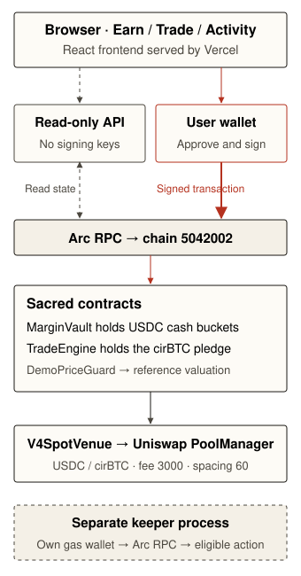

# Sacred Arc Testnet architecture

Sacred has a React browser app, a read-only TypeScript API and four deployed contracts on Arc Testnet (5042002). The browser signs through the user's injected wallet. The API never signs. A separate, gas-funded keeper can call the same permissionless settlement and queue methods available in the app.

## Onchain state and custody

- **MarginVault** holds USDC and accounts separately for depositor idle cash, outstanding principal, manager cash, primary/tail protection, optional backstop and reserved withdrawal claims. NAV is idle depositor cash plus principal receivables. Uncollected markup and protection cash are excluded.
- **TradeEngine** records the acquired cirBTC, fixed sale terms, principal and markup, then holds the cirBTC pledge. It applies repayments principal first, releases debt-free collateral and chooses bounded collateral sales.
- **V4SpotVenue** executes real swaps against the existing Uniswap v4 PoolManager in the fixed USDC/cirBTC pool (fee 3000, tick spacing 60, no hook). Its engine binding and callback checks constrain callers and settlement.
- **DemoPriceGuard** is an explicit admin-controlled reference fixture. It is independent of pool spot but is not a production oracle. The current expiry is shown in the UI.

The exact deployed addresses, constructor parameters and deployment receipts are in [the manifest](../deployments/arc-testnet.json). The runtime and money-flow checks are in [independent verification](review/CORE_LIVE_VERIFICATION.md).

## Offchain services

`server/reads.ts` pins contract reads to an observed block. `/api/config`, `/api/vault`, `/api/positions` and `/api/activity` return JSON with decimal integer strings, chain ID, observed block/time and the manifest policy hash. Activity scans at most eight 1000-block windows per request, with bounded concurrency and an opaque block/log-index cursor. The cache is ephemeral per server instance; the chain remains authoritative.

Vercel hosts static assets and Node read functions. It receives no wallet private keys. `RPC_URL_Arc_Testnet` is an optional host-only read RPC override; the public fallback may rate-limit. Studio proxy credentials remain sandbox-only.

The browser uses exact approvals, simulation, receipt confirmation and a subsequent authoritative data refresh. Confirmation-unknown and confirmed-but-outdated are distinct states. Recovery checks the existing transaction or refreshes data rather than sending again.

## Who advances state

| Transition | Caller and reason | If nobody calls |
| --- | --- | --- |
| deposit / requestWithdraw / claim | Depositor seeks exposure or exit | Funds or shares stay in their current state |
| open / ownerClose | Trader seeks exposure or exit | No new position / pledge remains |
| repay / repayAndRelease | Trader or payer reduces fixed debt | Debt remains fixed; pledge remains |
| rebalance / settleMatured | Gas-funded operator or participant protects or settles positions | Eligible work waits; impairment may block new deposits or reservations |
| processWithdrawals | Keeper or queued depositor assigns liquidity in FIFO order | Queue keeps priority and blocks new financing |
| seedProtection | Treasury funds protection | New financing waits for reserve targets |
| update demo price | Designated operator maintains the fixture | Price-dependent actions expire; repayment and reserved claims remain available |

## Operational trust

The guardian can pause funding and the price operator can block price-dependent paths by letting the fixture expire. Contracts are not upgrade proxies. Ordinary users keep wallet control and can call contracts directly without the hosted app. Source, policy and transaction history are public; RPC and hosting providers can see request metadata. Token-issuer and network controls still apply.

The MVP compromise is the small operator-priced testnet market. It is not a production safety or Shariah certification claim. There is no bridge in this release and no claim that a serverless API continuously runs the keeper.
